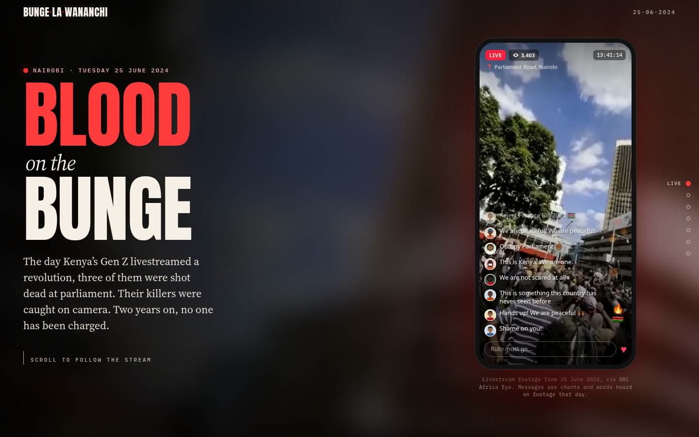
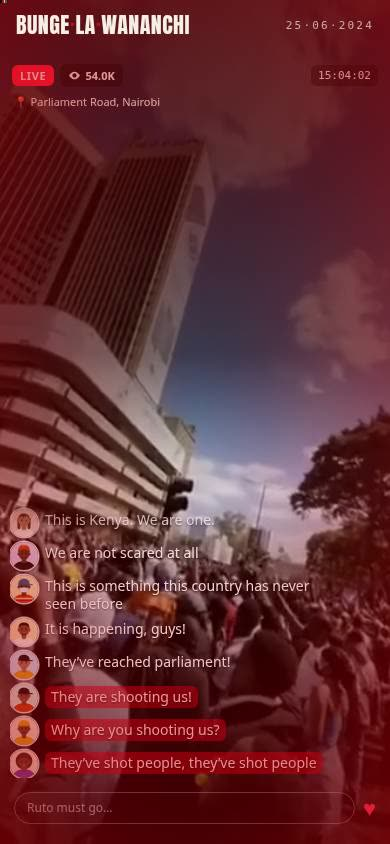
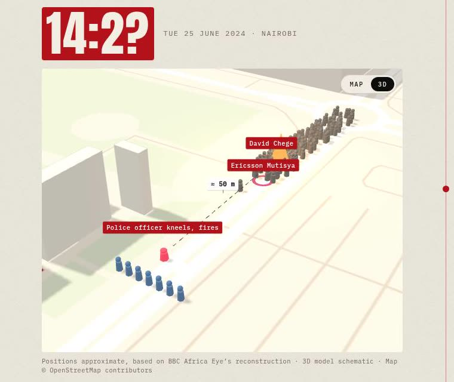
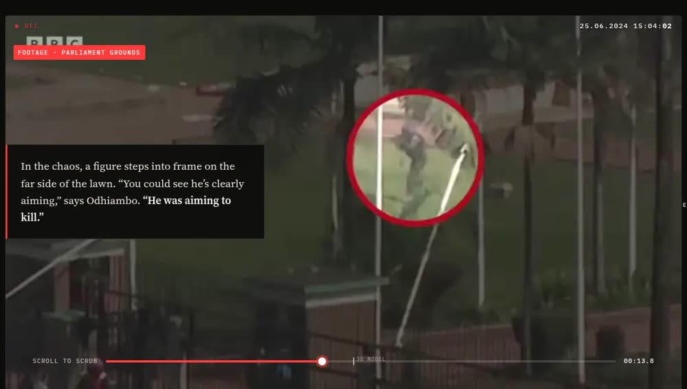

# Blood on the Bunge

**An interactive memorial and investigation of 25 June 2024, the day Kenyan security forces shot protesters dead at parliament.**

On 25 June 2024, more than 100,000 Kenyans marched on parliament to stop the Finance Bill. Three unarmed men, **David Chege**, **Ericsson Mutisya** and **Eric Shieni**, were shot dead on and beside its grounds. Their deaths were filmed from every angle. In 2025, BBC Africa Eye's investigation [*Blood Parliament*](https://www.youtube.com/watch?v=qz0f1yyf_eA) used more than 5,000 photos and videos to identify the police officer and the soldier who fired. Two years on, no one has been charged.

This site retells that investigation as a scroll-driven story: the day as it was livestreamed, minute by minute on a map of Parliament Road, then frame by frame through the evidence. It ends with what has happened since.

<p align="center">
  
  
</p>

> **Content warning:** the story describes killings and includes footage from the scene. The most graphic footage in the film is deliberately left out.

## The experience

### 1. The livestream
The page opens as a protester's livestream: real footage from 25 June, a LIVE badge, a climbing viewer count and a ticking clock. A chat scrolls past, made of chants and lines heard or captioned in footage that day ("Ruto must go!", "We are peaceful!", "We've entered!", "Why are you shooting us?"), posted by procedurally drawn SVG avatars. As you scroll, the stream moves through the day: calm, then the breach, then the shooting. It glitches and cuts to *Stream interrupted · Connection lost 16:30*, the time internet access across Kenya collapsed that afternoon. On phones the stream fills the screen, and the scroll snaps to each beat so a flick can't skip one.

### 2. The day, minute by minute, on a live map
A sticky clock and a map of Parliament Road, built from OpenStreetMap data, follow the timeline. They show crowds converging from three directions, police lines falling back, the vote (195 to 106), the burning truck and both shootings, with the 50 m and 25 m distances drawn to scale. At 14:20, as protesters reach parliament, **the map turns into a three.js model**. The 3D view starts directly overhead, lined up with the flat map, then tilts down to street level. It flies to each scene using the BBC's colour code: red for the shooter, yellow for Eric. A toggle switches between 2D and 3D.

<p align="center"></p>

### 3. Scrubbing the evidence
In the Eric Shieni chapter, scrolling steps frame by frame through the footage and then the BBC's 3D reconstruction, with an editor-style timecode bar. Each text card lands on its matching frames. A forensic sequence then pins the uniform details investigators matched (helmet, shoulder patch, boots, rifle) and zooms into the black, red and green badge that identifies the Kenyan army.

<p align="center"></p>

### 4. After
What followed: the bill's withdrawal, the government's response to the film, the 2025 and 2026 anniversaries, and the state of accountability (of 62 deaths in the 2024 protests, three cases have reached a courtroom). It ends with Ericsson Mutisya's mother's words between barbed wire. Visitors can **hang a flower on the wire**, as families did outside parliament in June 2026. The flowers are shared: everyone sees everyone's.

## Accuracy

- Every factual claim is attributed. Sources are listed at the bottom of the page and below.
- Identifications are the BBC's. Neither shooter has been publicly named. The page names only the plain-clothes officer the BBC identified as urging others to "kill", and notes that he did not respond.
- Map positions are **approximate**, based on the BBC's reconstruction, and the 3D model is schematic. Both are labelled as such on the page.
- The internet disruption is described as what is established: a nationwide drop from about 4:30 pm for about 7 hours. The operators blamed undersea cables, while researchers found hallmarks of a shutdown. The page does not claim the internet was deliberately cut.

## Built with

Plain HTML, CSS and JavaScript, with no build step.

- **[GSAP](https://gsap.com) + ScrollTrigger** for scroll choreography (vendored in `js/vendor/`, so nothing waits on a CDN)
- **[three.js](https://threejs.org)** r149 for the 3D map, lazy-loaded as the reader approaches the timeline
- **OpenStreetMap** data, exported to SVG (2D) and to footprints and heights (3D)
- **Canvas** frame sequences for the scrubber (198 WebP frames, lazy-loaded)
- A small **serverless API** for the shared flowers (Vercel + Upstash Redis), mirrored by a Python dev server

Footage was cut with `yt-dlp` and `ffmpeg`, and the film was transcribed with `faster-whisper` to source quotes accurately.

Accessibility and performance: honours `prefers-reduced-motion`; footage loops play only while on screen; heavy effects are dropped on phones; works without WebGL (the map stays 2D) and without the API (flowers stay local).

## Project structure

```
index.html            the story; the 2D map is inline SVG
css/style.css         all styles, one file, sectioned
js/main.js            livestream, timeline, map hand-off, scrubber, flowers, scroll choreography
js/map3d.js           three.js scene for the 3D map (window.Map3D)
js/vendor/            GSAP, ScrollTrigger, three.js
assets/img/           portraits and evidence stills
assets/video/         livestream clip and footage loops (+ posters)
assets/scrub/         frame sequence for the scrubber
assets/map3d-data.js  building footprints and heights from OpenStreetMap
api/flowers.js        Vercel function: shared flowers (Upstash Redis)
dev/server.py         local server: static files + the same /api/flowers on a JSON file
docs/                 README screenshots
```

## Run locally

```bash
python3 dev/server.py          # http://127.0.0.1:8765
```

`dev/server.py` serves the site with HTTP Range support (iPhones need it for video) and runs `/api/flowers` against `dev/flowers.json`. Delete that file to clear the wire. To share a local copy temporarily:

```bash
cloudflared tunnel --url http://127.0.0.1:8765
```

## Deploy to Vercel

1. Import the repository as a Vercel project. Framework preset **Other**, no build command, output directory = repository root.
2. Under **Storage**, add **Upstash → Redis** (the free tier is plenty) and connect it to the project. This sets `KV_REST_API_URL` and `KV_REST_API_TOKEN`.
3. Redeploy. `api/flowers.js` becomes the live `/api/flowers`. `dev/` and `docs/` are excluded by `.vercelignore`.

### Flower API

| Request | Response |
| --- | --- |
| `GET /api/flowers` | `{ total, flowers: [{ id, x, f, r }] }`, newest first, at most 150 |
| `POST /api/flowers` with `{ x, f, r }` | `201 { total, flower }`; values are clamped server-side |

Visitors are limited to one flower every 2 seconds and 20 an hour (`429` beyond that). Limits key on a hash of the IP address; addresses are never stored. Flowers carry no text, so there is nothing to moderate.

## Sources

- [*Blood Parliament*](https://www.youtube.com/watch?v=qz0f1yyf_eA), BBC Africa Eye documentary, 2025
- ["They aimed to kill": BBC identifies security forces who shot Kenya anti-tax protesters](https://www.bbc.com/news/articles/c8jexr9yv0do), BBC, 28 Apr 2025
- [Pressure mounts to probe Kenya police and army after BBC exposé](https://www.bbc.com/news/articles/cy9vrz4q1v8o), BBC, 29 Apr 2025
- [The Kenya June 25, 2024 internet disruption: subsea cable cut or shutdown?](https://ioda.inetintel.cc.gatech.edu/reports/the-kenya-june-25-2024-internet-disruption-subsea-cable-cut-or-shutdown/), IODA, Georgia Tech, May 2025
- [#KeepItOn throughout protests in Kenya](https://www.accessnow.org/press-release/kenya-protests-internet-shutdown/), Access Now, 25 Jun 2024
- [16 dead in anniversary protests](https://www.cnn.com/2025/06/25/africa/kenya-anti-tax-anniversary-protests-intl), CNN / Amnesty Kenya, 25 Jun 2025
- [Kenya's repression deepens](https://monitor.civicus.org/explore/kenyas-repression-deepens-65-more-killed-in-protests-blogger-tortured-killed/), CIVICUS Monitor, Aug 2025
- [Two years on, Kenyan families still seek justice](https://www.aljazeera.com/news/2026/6/25/two-years-on-kenyan-families-still-seek-justice-after-gen-z-protests), Al Jazeera, 25 Jun 2026
- [Families lay flowers on barbed wire on anniversary of deadly Kenya protests](https://www.bbc.com/news/articles/cgqjl8kj8wpo), BBC, 25 Jun 2026


## Credits and licence

The findings belong to the BBC Africa Eye team: filmed, produced and directed by Bertram Hill; executive producer Pete Murimi; film editors Valeria Cardi and Emile Costard; investigators Victoria Arakelyan, Courtney Bembridge, Rüzgar Mehmet Akgün and Regan Wharton; 3D design by Martyna Marciniak. With thanks to the photojournalists who cannot be credited for their own safety.

The **code** is released under the [MIT licence](LICENSE). The **footage, stills, map data and vendored libraries are not**. They belong to their owners and keep their own terms; see [`NOTICE.md`](NOTICE.md).

*In memory of David Chege, Ericsson Mutisya, Eric Shieni, and everyone killed, disappeared and injured in Kenya's protests since June 2024. Haki.*
